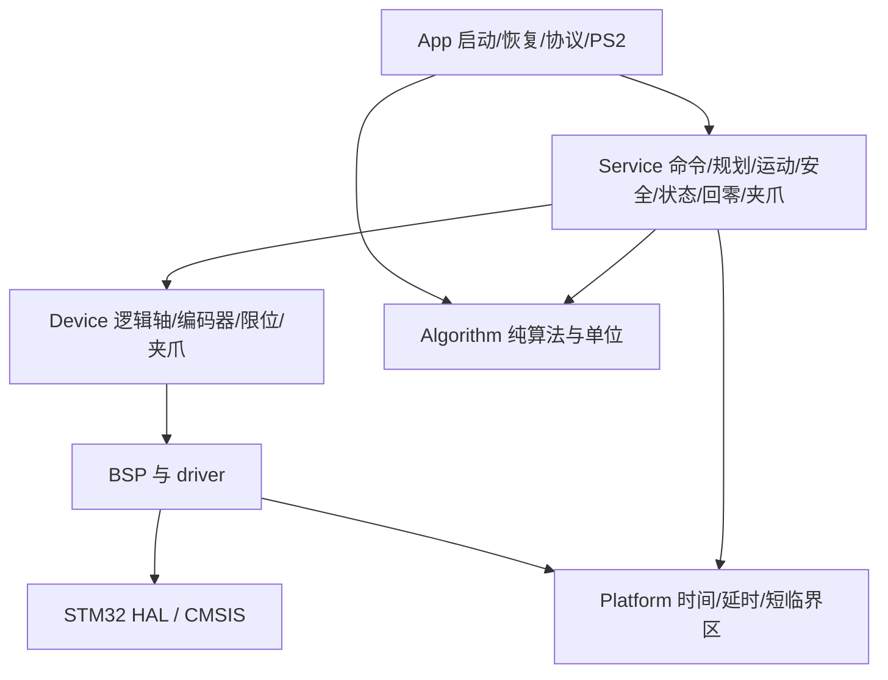
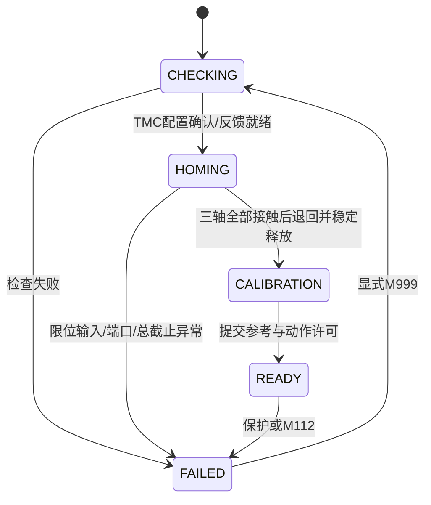

# 软件架构

生产入口为 `ProductionRelease`，正常启动三轴并行寻位、接触屏障后并行退回。源代码按责任分层，旧教学/诊断入口保留独立编译选项。

| 层 | 职责与主要文件 |
|---|---|
| App | `app_runtime.c`编排启动、恢复和模式；`app_serial_protocol.c`组应答；`app_teleop.c`处理PS2；`adapters/`明确解释硬件回调 |
| Service | `command/`维护路径点；`planning/`校验和生成轨迹；`motion/`执行帧与闭环；`safety/`拥有首故障；`state/`拥有逐轴反馈；`homing/`与`gripper/`管理业务生命周期 |
| Device | M1/M2/M3到驱动与反馈器件的绑定，不解析串口文本 |
| BSP/driver | 引脚、定时器、UART/I2C/PWM及TMC2209/AS5600/PS2/MG90S器件协议 |
| Algorithm | 运动学、角度/微步换算、纯回零状态机、GPIO消抖，不访问HAL |
| Platform | 时间、计时回绕、短临界区，不决定运动任务 |

依赖由 `scripts/check_architecture_dependencies.py` 检查：跨域只用公开接口，`internal/`只属于本服务，业务公开头文件不得间接泄漏HAL。App/adapters是显式硬件边界。

## 命令调用链

`USART1 DMA → uart_line_reader → AppSerial → GCodeParser → CommandService → PlanningService → Ctrl_Planner → MotionService → Ctrl_MotionEngine → Dev_Joint → Drv_Stepper`。

路径先校验，再按预算生成分段；坐标FIFO、规划状态与STEP队列分别管理。G0/G1受理不是运动完成，M400等待路径和步进队列完成，并依据三轴新鲜反馈、稳定窗口和到位死区确认闭环已收敛。M112同时取消未来命令和当前执行，撤销参考。

## 启动和恢复

M1/M2 D0、M3 D1寻位，各到达后停步等待；全部稳定触发才并行反向退4068/1160/160微步。寻退周期1ms，即1000微步/秒；每轮220秒总截止，无单轴30秒正常寻位截止。完成释放确认和反馈零偏标定后READY保持EN使能。

## 采样与并发

限位PC10/11/12为普通上拉GPIO，1ms采样；首低先暂停STEP，低稳定10ms确认压下，高稳定10ms取消短脉冲或确认释放，持续不稳定100ms进入故障。回零期间按回零阶段处理，正常运动碰限位则停止锁定。SW7/PE2仍用EXTI产生模式事件。

中断内不打印、不做I2C、不延时或生成轨迹；STEP消费有界帧、不补发欠步。主循环处理协议、规划、反馈和失败映射。TMC静音配置在启动/M999、EN禁用时完成，不在PS2轮询中阻塞总线。

LED1按当前模式常亮/慢闪，LED2/3/4只显示原始限位。显示不能反向决定模式或动作许可。

## 位置与闭环

只有HOMED有效且无锁存故障才能使用参考坐标。规划XYZ不等于末端实测位置，编码器电机角不等于关节角。G-code空闲时运行自主补偿，PS2模式保留反馈和保护而不自主补偿。恢复窗口≤10°关节、每轮≤1°、总期限20秒；超窗、无进展、发散或输入异常即停。具体参数见 [控制参数](control.md)。
